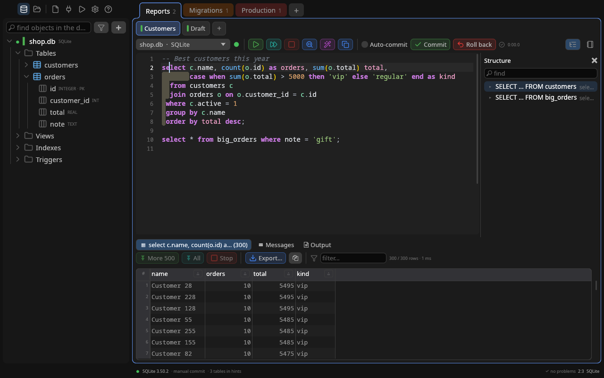

# zapros

An SQL IDE for Linux in Rust (egui) for **PostgreSQL**, **ClickHouse**,
**Oracle** and **SQLite**.



## Install

- **Arch Linux**: the `.pkg.tar.zst` from
  [Releases](https://github.com/sendement/zapros/releases)
  (`sudo pacman -U zapros-*.pkg.tar.zst`), or build it with the
  [PKGBUILD](packaging/arch/PKGBUILD) there.
- **Flatpak** (any distribution), from zapros' own repository — updates
  come with `flatpak update`:

  ```sh
  flatpak install --user https://sendement.github.io/zapros/zapros.flatpakref
  ```

  The Flatpak carries libaio, so an Oracle Instant Client downloaded in
  Settings → Drivers works there as is.
- From source: see [Building](#building).

## Features

- **Never freezes on the network.** Each connection runs on its own threads:
  one session for scripts, one for the object tree and hints. Slow links,
  dropped connections and long queries never block the window; a lost
  link is re-opened on the next request; a query can be stopped (PG cancel
  request, ClickHouse `KILL QUERY`, Oracle break, SQLite interrupt), and one
  the server won't stop can be abandoned (its session is made anew). A
  ClickHouse session still busy a few seconds on (SESSION_IS_LOCKED) gives
  way to a new one, with a note in Messages.
  Tabs and notebooks on one connection share its script session: their
  runs take turns, and Stop is for one run — a run still waiting its turn
  is just dropped, the one running in another notebook goes on.
  Links a firewall or a VPN drops silently are caught: PostgreSQL TCP
  keepalives (a dead link is told within about a minute), Oracle
  `EXPIRE_TIME` probes each minute, and a session idle for over a minute
  is pinged (10 s) before use, made anew when it doesn't answer. ClickHouse
  over HTTP has no heartbeat, so a query whose answer is awaited is looked
  for in `system.processes` from aside every 20 s: gone there and still no
  answer, the wait is cut and how it ended on the server (from
  `system.query_log`: finished, rows written, or its error) is told; the
  server not answering for over a minute cuts the wait too. A window the compositor
  doesn't show (another workspace or screen) no longer turns "not
  responding": no vsync wait, frames paced by hand.
- **Two rows of tabs.** Workspaces (named, coloured, each with its own
  default connection) are tabs over a sheet whose outline, in the
  workspace's colour, runs on from the active tab; on the sheet, the
  workspace's scripts, the editor and the results. Tabs and their text
  live in the session and come back on start. The side panel runs the
  full height, its top row holding the panel switch (objects / files) and
  the menus as icons; the list lies on a rounded card of its own, level
  with the sheet beside it.
- **Transactions** (PostgreSQL, Oracle, SQLite): auto-commit per
  connection (off by default), switchable from the toolbar. A SQLite
  transaction that only read is ended at once. With it off, changes gather
  until Commit or Roll back; the toolbar and status line show when some
  are pending, and switching auto-commit on, disconnecting or closing the
  window asks what to do with them. In PostgreSQL each statement runs under
  a savepoint, so one that fails is undone alone and the transaction goes
  on. ClickHouse has no transactions: the controls hide.
- **Errors in plain words** (PostgreSQL, ClickHouse, Oracle, SQLite): the
  server's answer read by its code — "no column «totl»", "the statement ends
  too early", "column «total» must be in GROUP BY…" — with the name it's
  about underlined in the code (the server's position, or where the name
  is). An unknown name is read in its context, whatever the server's
  words: a wrong alias before a dot ("no table or alias «x» in the
  statement — maybe «o.total»?", the aliases whose tables have that
  column; for `x.*` just the aliases there are), a column its alias'
  table lacks (that table's alike columns, or the other table that has
  it), a bare column (alike ones, with their alias when there are several
  tables; or the table the statement doesn't name that has it; "Bob" in
  double quotes → strings take single quotes), a call (no such function,
  alike functions; a column called like one), a table after FROM / JOIN
  (alike tables, or another schema that has it). Then a guess at what was meant (the server's own, or the nearest names of
  the statement's tables, the database's tables or functions), the code as
  a button that copies it, and the server's whole text unfolded under
  "Full log…" with Copy all.
- **Another schema's code in Oracle** without SELECT_CATALOG_ROLE:
  where DBMS_METADATA refuses (ORA-31603) though the object's own grants
  let it be seen, its DDL is put together from ALL_SOURCE, ALL_VIEWS,
  ALL_MVIEWS, ALL_SEQUENCES, ALL_SYNONYMS and the table's columns, keys
  and comments (a package's body shows as far as Oracle lets the user see
  it).
- **The object tree is kept**: on disk between runs (shown at once on
  start, looked at again once its connection is up), and in place on a
  refresh — the old list stays till the new one's in, then what's new
  comes into it and what's gone goes; a refresh that fails leaves it as it
  was.
- **Object tree** per connection: schemas / databases, tables, views,
  materialized views, functions, procedures, packages, sequences, triggers,
  types, synonyms, dictionaries, jobs (Oracle Scheduler, pg_cron); columns,
  keys, indexes. Double-click opens an object's DDL; "first 200 rows",
  "insert SELECT with all columns", copy / insert names. **Ctrl+click**
  opens an object in a tab right beside the current one: a table or a job
  as a designer (Designer | Code over it), anything else as its code.
- **Names quoted only where needed** (Settings → code style, on by
  default): an object's code from the database and formatted text lose
  the quotes they don't need — Oracle's `"SHOP"."ORDERS"` → `SHOP.ORDERS`,
  ClickHouse's `` `id` `` → `id`; `_`, `$` (and Oracle's `#`) stay bare;
  names with spaces, in another case or that are reserved words (`DATE`,
  `USER`…) keep theirs.
- **Indexes in the table designer**: the table's indexes under its columns
  — name, columns or expressions (ascending / DESC; picked from the
  table's columns or typed), UNIQUE, type (PostgreSQL btree / hash / gin /
  gist / brin…, Oracle NORMAL / BITMAP, ClickHouse's data-skipping minmax /
  set / bloom_filter… with GRANULARITY), a partial index's WHERE
  (PostgreSQL, SQLite). Added, dropped, changed (made anew) or renamed
  (ALTER INDEX … RENAME where the database can); a constraint's index (a
  primary key's, UNIQUE's) is shown, changed through the constraint.
- **A table from a file** (a schema's or its Tables folder's menu: "New
  table from a file…"): CSV / TSV (separator and UTF-8 / Windows-1251
  found by themselves), XLSX / XLS / ODS (a sheet to pick), JSON (an array
  of objects or one a line). The file picked in the window (or dropped on
  it); its columns listed with types guessed for the database (integers,
  numbers with a comma or spaces, true / false, dates as ISO or
  dd.mm.yyyy, date and time, text as long as needed) — each taken or left,
  renamed, its type picked or typed, NULL allowed; the table's name, its
  key (ClickHouse: its ORDER BY) and indexes over fields picked in order.
  The first rows and the SQL shown; then made and filled in batches with a
  progress bar and Stop. Failed or stopped, the table is dropped: none of
  it or all of it.
- **Several windows at once** share their workspaces and tabs: what's
  changed in one (text, tabs opened or closed, workspaces) shows up in the
  others within a moment, each window staying on its own tab. A tab being
  typed in is held by its window: in the others it's read-only (its text
  following as it's typed) under a note with "Edit here" to take it over;
  a few seconds idle and it's free again. Edited in two windows at once
  anyway: nothing's lost, the other window's version comes in as a copy
  beside it.
- **Table designer**: the columns as a grid — name, type (common ones in a
  list), NULL, default, comment; columns added, renamed, changed, dropped
  (and undropped); the table's comment. The ALTER / COMMENT statements it
  takes are shown as they're made (per database: PostgreSQL, Oracle,
  ClickHouse, SQLite — where SQLite can't change a column it says so), then
  applied, reset or opened as a script; keys, indexes and the engine are
  listed below.
- **Jobs** (Oracle Scheduler, pg_cron): double-click (or Ctrl+click) opens
  a tab beside with the job's schedule set by hand — every N minutes, hourly, daily, on days
  of the week, on days of the month (the last one too), at one or several
  times — written as `repeat_interval` or cron, in words, with the next five
  runs; an expression the designer can't read is edited as text. Also
  enabled, what it runs, the comment, its state and last / next run.
  The script it makes (CREATE_JOB / SET_ATTRIBUTE, `cron.schedule` /
  `cron.alter_job`) is shown under it, pinned with Apply; "New job…" on the
  Jobs folder opens a blank one (its Code: the script that makes it).
- **Help on Ctrl+click**: a function (count, coalesce, date_trunc,
  toStartOfMonth, NVL, strftime…), an operator (||, ::, ->>, @>, <=>…) or a
  keyword (LEFT JOIN, OVER, EXISTS, BETWEEN, CONNECT BY, PREWHERE…) opens
  its help — how it's written, what it does (each database's own version
  first: length counts bytes in ClickHouse), an example to copy. Help goes
  by where the word stands: ORDER BY in `KEEP (DENSE_RANK LAST ORDER BY …)`,
  in `OVER (…)`, in `WITHIN GROUP (…)`, in `string_agg(… ORDER BY …)` and in
  a MergeTree table each has its own; so do DENSE_RANK / FIRST / LAST in
  KEEP, a window's frame, NULLS FIRST, DISTINCT ON, ON CONFLICT, MERGE's
  ON / WHEN MATCHED, START WITH, WITH TIES / FILL / TOTALS. The reference is
  src/sql/help.txt.
- **Ctrl+click in the code** (the script and notebook cells; with Ctrl held
  the name under the pointer is underlined): an alias — its table (or CTE)
  picked and lit; a CTE's name — its definition; a function or procedure of
  the script itself (a package body's) — there; a column — the statement's
  table that has it; a table — its designer in a tab beside; a view,
  function, procedure, package, sequence… — its code in a tab beside
  (schema-qualified, `package.member` and synonyms too).
- **Colour schemes**: Windows 11 Dark / Light, Dracula, Ubuntu / Ubuntu
  Light, One Dark, JetBrains Darcula, Monokai, Nord, Solarized Dark / Light,
  GitHub Dark / Light, Gruvbox, Catppuccin Mocha / Latte, Tokyo Night —
  window colours and the editor's palette together (Settings → Look); the
  standard look follows the system or is set dark / light.
- **Aliases in their own colours** (Settings → Colours): a table's alias
  ("orders o", "(select …) t") and where it's used ("o.id"), a column's
  alias ("sum(x) AS total", "count(*) n") and where it's used (ORDER BY,
  GROUP BY, HAVING). Schemas / users before a table's name ("shop.orders",
  CREATE TABLE app.users, the first of three parts) in a colour of their
  own too.
- **Rainbow bands** go on across blank lines inside a construct (as far as
  the lines around have them), their outer corners rounded.
- **Selection** drawn by zapros: the text keeps its colours, the rainbow
  bands show through in another shade, the corners rounded outside and in.
- **Code style** (Settings → Code style): keyword and function case;
  the case of optimizer hints (`/*+ full(t) */`; aliases in their
  brackets follow the aliases' case), schemas, tables, columns, table and
  column aliases (as typed by default; quoted names never change; in
  ClickHouse, case-sensitive, schemas, tables and columns stay and an alias
  changes only when all its uses in the statement are found); a new line
  after SELECT's hint and after DISTINCT;
  calls (if(…), coalesce(…)) and windows (OVER (PARTITION BY … ORDER BY …))
  longer than a set length split over lines even when the line fits;
  keywords take that case as they're typed (only SQL's own words where they
  are keywords — names, `x.word`, strings, comments and calls stay; in
  ClickHouse, whose functions and names are case-sensitive, neither typing
  nor formatting touches them); the formatter's layout — the "river" or
  plain (clause words at the left, lists indented), commas leading or
  trailing, the indent per level; a line width past which a long item is
  split (a call's arguments one to a line, a || + − chain before its
  operators, indents kept); short statements on one line up to a length.
- **Title bar** (Settings → Look): the desktop's, or the window's own —
  the tabs' row drags the window (double click: maximize), the edges
  resize it, the window's buttons in a style (as the desktop's, Breeze,
  Adwaita, Ubuntu, macOS, Windows 11, simple), order and side picked with
  previews (as in Polka).
- **Dragging tabs**: workspaces and scripts alike, a copy of the tab under
  the pointer, the tabs changing places as it passes them; notebook cells
  lifted and carried by their grip, the others sliding aside to make room.
- **Search**: Ctrl+F opens a search window — in this script (all
  its cells), the workspace's scripts or every tab; any case or as typed,
  whole words; matches lit, Enter / Shift+Enter between them, a list of
  them across tabs; replace one or all. Its "in the database's code" scope
  searches the code of views, materialized views, functions, procedures,
  packages, triggers and jobs (PostgreSQL, Oracle's ALL_SOURCE, ClickHouse,
  SQLite) and shows cards with the lines found; a double click opens the
  object beside with the match picked.
- **Object tree**: its search box, from two letters, looks through the
  whole database by name (not only what's open), grouped by schema; a
  filter button picks the schemas / databases each connection shows
  (hide the ticked, or only the ticked).
- **Notebook cells** run, stop and explain themselves (▶ Run, 🔍 Plan, ■
  Stop on each SQL cell; the toolbar's run / script / stop / plan stay with
  the plain text; Shift+Esc stops every cell). A cell's header shows how
  its run went: blue while it runs, green when done, red on an error,
  yellow on a warning (stopped by hand, a server WARNING, an UPDATE /
  DELETE that changed no rows); the colour stays while the cell has the
  focus and fades a few seconds after it's gone.
- **Notebook cells' headers stick** to the top of the view while the cell
  is scrolled up under it (over the cell, its buttons working there), until
  the cell itself is gone. A cell being dragged by its grip folds to its
  header for the move. The notebook scrolls on until its last cell is at
  the top; the wheel scrolls it while a selection's dragged in a cell,
  whatever the cells below hold.
- **A hung run ended by force**: when the server doesn't answer Stop within
  3 seconds, Stop turns into ⚡ Kill (in the toolbar and on a notebook
  cell; or Shift+Esc again). The session is given up on and a new one
  opened (its uncommitted changes are lost; runs of other tabs queued
  behind it go on in the new one), and the hung session is ended on the server from the other
  one: PostgreSQL `pg_terminate_backend`, Oracle `ALTER SYSTEM KILL
  SESSION` (when the user may), ClickHouse `KILL QUERY`.
- **Script directives** — loops and variables for servers with no
  procedural language of their own (ClickHouse first of all), in `-- @…`
  comments so the script stays SQL: `@set` values, lists, dictionaries and
  query results; `@for` over ranges (numbers keeping leading zeros, dates
  by day / hour / month…, letters), lists, dictionaries and query rows;
  collections changed by a pipe (`ls | push x`, `| pop 0`, `| remove x`,
  `| map it * 2`, `| filter it > 3`, `| sort by it.n desc`, `| unique`,
  `| join`, in place `@ls |= pop`);
  `@while` (a query in its condition: waiting for mutations), `@if` /
  `@elif` / `@else`, `@match` / `@case`, `@print`, `@pause`, `@on error`.
  In SQL `:x` puts a value in, `&x` text as it is (`events_&i`,
  `&{d | date yyyymmdd}`). Progress by the results, Stop ends the loop; a
  notebook's cells share their variables. In the editor directives have
  their own colours (loops, conditions, variables — set in Colours, the
  `--` faint), rainbow bands and frames for their blocks, indents by Enter
  and by the formatter, hints after `-- @` and for variables after `&` /
  `:`, help on Ctrl+click. See [docs/directives.md](docs/directives.md).
- **Optimizer hints** (`/*+ index(o orders_idx) */`) are coloured: the
  hint, its brackets, its tables and aliases each their own.
- **A notebook from a script** is cut only at its `-- %%` marks; without
  them the script stays one cell (comments and directives don't cut it).
- **Quitting with queries running** asks first: stop them and quit (the
  servers are told to stop, and it closes once they say so, 5 s at most),
  wait for them to end and quit, or quit leaving them be (a server may then
  go on running them: PostgreSQL until it has something to send, ClickHouse
  to the end). Uncommitted changes are asked about once the runs are over.
- **Notebook cells** carry the time they were made and colour labels
  (their colours and names set in the filter's menu, more added, any
  removed); the notebook's filter — text, labels wanted (any / all) or left
  out (the dots cycle wanted → left out → any), when made (today, 7 or 30
  days, between dates) — opens the cells that fit and hides the rest.
- **Fonts** (Settings → Look): the interface's, the code's (with its line
  gap) and the tables', any installed family (searchable list, monospaced
  first where it fits), each with its size; a preview of all three.
- **A stopwatch** by every spinner of a running query (the toolbar, the
  script's tab, a notebook cell, rows being fetched): 0:03.4, 12:05.0… Once
  it's over, the last run's time stays there (✓ 0:03.4; amber if cancelled).
- **Notebook cells** are dragged up and down by their grip (a line shows
  where they'd go; the notebook scrolls near its edges); each has its own
  Format and Copy; the top bar's Format lays out every SQL cell (Markdown
  stays). The plain script has Copy too (the script, or what's picked), and
  its code lies on the same rounded ground as a cell's.
- **Markdown cells**: a right click while editing gives bold, italic,
  strikethrough, inline code, link, headings, lists (bulleted, numbered,
  checklist), quote, code block, table, divider — on the picked text or
  its lines (again: off). Shown: strikethrough, checklists' boxes, tables.
- **Icon packs** (Settings → Look): Lucide, Tabler, Phosphor, Codicons,
  Fluent, Material Symbols, Iconoir, Bootstrap — or the font's symbols as
  before — in the object tree, the files panel and the toolbars; tinted by
  the scheme, the tree's kinds (tables, functions, triggers…) in the
  palette's colours if wished. What a pack lacks comes from the pack nearest
  in look; licences in `assets/icons/LICENSES.md` and in About.
- **Backdrop gradient**: behind the tabs, panels and status line, any
  number of colour stops, linear at an angle or from the centre, its
  strength over the scheme's own backdrop; presets to start from.
- **Packages in two parts.** An Oracle package (opened from the tree or a
  file) shows its specification and body as two sub-tabs (Alt+1 / Alt+2),
  each run (compiled) on its own and saved together; the script's "/"
  after each is left out on screen and put back when they're joined.
- **Structure panel** (Ctrl+Shift+O) beside the editor: the script's
  statements and the objects they create; in a package its functions,
  procedures, types, subtypes, cursors, exceptions, constants, variables
  and initialization (both parts when split). A click goes there, a double
  click on a declaration goes to its body; the entity under the cursor is
  lit; a search narrows it.
- **Project files** in the same panel: a folder of `.sql` scripts.
- **Static analysis while typing**: unclosed strings, comments and
  brackets, `CASE` without `END` — and in PL/SQL and PL/pgSQL bodies
  `BEGIN` / `IF` / `LOOP` without their `END` — get a red background until
  fixed; stray commas, empty `WHERE` / `FROM`, an operator with nothing
  after it are errors; `UPDATE` / `DELETE` without `WHERE`, `JOIN` without
  `ON`, tables and `alias.columns` the database doesn't have are underlined.
  Hover for the reason. Running a script with errors asks first.
- **Hints**: columns after `alias.`, tables after `FROM` / `JOIN`, a join
  condition guessed from column names after `ON`, keywords and functions of
  the dialect, snippets (`sel`, `case`, `cte`, …). CTEs of `WITH` and
  subqueries in `FROM` count as tables, with the columns their `SELECT`
  gives (`*` opened up); in a notebook, the CTEs of WITH cells above too.
  By the clause: in `GROUP BY` what the query's SELECT has (its aggregates
  left out), in `ORDER BY` its aliases, in `HAVING` its aggregates and
  `COUNT(*)`, `SUM(…)`… first. In a call of a function or procedure (after
  `(` or `,`) its parameters by name, `p_id => `, with their types, IN /
  OUT and defaults (PostgreSQL functions and procedures, Oracle's with
  packages'). What the place suggests goes first in the list. A subquery's
  or CTE's columns go in as they're written there (no quotes added).
  Names get quotes only where the database needs them (`system.query_log`,
  a `type` or `comment` column go in bare). Without a connection (not
  connected yet, offline, after a restart) hints go on with the tables and
  routines last loaded, kept on disk per connection.
- **The likely next words, dimmed** after the cursor until you type
  something else; Tab takes them: after `GROUP BY` the SELECT's
  expressions not grouped yet, after `ORDER BY` its next alias, after
  `HAVING` its aggregate, after `ON` the join's condition, in a call its
  next parameter (`p_id => `), in `INSERT INTO t (` the table's columns.
  A setting turns it off.
- **Ctrl+click on a SELECT's `*`**: the columns it stands for (with their
  tables when there are several), to copy comma-separated or one a line,
  or to put in its place — all or those ticked.
- **Shortcuts of your own** (Settings → Shortcuts): each command's keys
  listed — click one and press a new one, "+" adds another, right click
  removes, ↺ brings back the usual ones; a key two commands share is shown
  in red with whose it is. Menus and tooltips show the keys as set.
- **Settings** in sections at the side, the section's settings beside
  them; the window stays in the middle.
- **Boards** (Side panel → Boards): a canvas beside the scripts, each
  board in a tab of its own and kept by itself (a JSON file in the data
  folder). A library on its left, dragged from (or clicked): the
  databases' tree (tables, views, routines of any saved connection, with
  their columns), the workspaces with their tabs and notebooks' cells,
  shapes (rectangle, ellipse, diamond, start / end, input / output,
  database, preparation, sticky note, text, table entity), lines (arrow,
  plain, dashed, dotted, both ways, thick — a click sets how the Link
  tool draws, a drag puts a line of its own with ends to pull) and
  backgrounds (zones with a title: plain, dots, grid, stripes; the
  board's own: dots, grid, lines, plain).
  A script on the board is drawn by what its statements do: a query as a
  table of the columns it gives (its CTEs, `*` and expressions worked
  out), INSERT as a frame with the source (a query's columns or VALUES'
  rows), an arrow and the target table, UPDATE / DELETE / MERGE /
  CREATE TABLE as an arrow to the table (the columns set or defined), a
  DECLARE / BEGIN block or a routine's code in full, folded to its first
  line by its ▾; several statements: a frame of them. A workspace is a
  frame round its tabs' frames; frames are laid out about square, not in
  a long ribbon, a notebook's markdown notes across the top of the
  statements after them (a header with its description). A table the script creates is known to the statements
  after it (their INSERT / UPDATE / SELECT show its columns).
  A click picks; a double click (or "Properties…" in the right-click
  menu) opens a window in the middle with what it holds — a statement's
  script, a table's fields, a link's look — and "Refresh" to take the
  tabs as they are now. The right-click menu also opens the object or
  goes to the tab, duplicates, moves to front / back, deletes.
  Frames with text typed right in them, free text, a brush; table
  entities with their fields (keys, types) and a note; arrows from and
  to anything at any depth: an item, a workspace's tab, a statement in
  it, a table of a statement's scheme, any of their fields — with a
  label and their own look. Links run along x and y only, round what's
  between (frames, tables, shapes — not backgrounds or a frame round an
  end; a search with a price per turn, so few corners), and are drawn over
  everything. Drag empty space or the middle button to pan,
  Ctrl+wheel to zoom, Shift+drag to pick by a box, Ctrl+Z /
  Ctrl+Shift+Z, Ctrl+D a copy, Delete; tools by keys V R O D T B E A.
- **SQLite triggers** (`CREATE TRIGGER … BEGIN …; END;`) run and split
  as one statement.
- **The side panel put away** by its button at the window's corner (it
  stays there either way; Ctrl+B),
  a double click on its edge, or its edge pulled well past its narrowest;
  its menus go beside the workspaces then, and pulling from the window's
  edge brings it back.
- **Lines moved** with Alt+Shift+↑ / ↓: the caret's line, or all the
  selected ones.
- **Formatted as pasted** (a setting, off at first): pasted code, or a
  selection put in brackets, and the statements it lands in are laid out
  at once. Brackets a paste leaves open (`count(`) are closed after it,
  unless the statement closes them further on. Ctrl+Z first takes back
  the tidying, the next one the paste itself.
- The text **follows the caret** moved by the keys (in notebook cells
  too), and the wheel while selecting scrolls at its full speed.
- **Parameters**: a statement with `:name` or `&name` (`&&name`) asks for
  their values before it runs. `:name` is a value: a number goes in as is,
  anything else in quotes, nothing is NULL (or picked: text, number, as
  is, NULL); `&name` is text put in as it is (a table's name, a piece of
  SQL). The statement is shown as it'll run; values are kept for the next
  time; "Run as written" leaves them alone. Strings, comments, `::` casts,
  `:=` and a trigger's `:new` / `:old` are not parameters.
  Schemas can be put in
  quotes always (a setting). Another setting puts the word as typed first in the list,
  picked: Enter then just starts a new line (an alias needs no hint), a
  hint is taken with ↓ and Enter / Tab.
- **SQL inside strings.** Dynamic SQL (`EXECUTE IMMEDIATE`, PL/pgSQL
  `EXECUTE`, `OPEN … FOR`, `format()`, `DBMS_SQL.PARSE`), strings kept in
  variables that end up there, literals reading as a statement, and
  PostgreSQL `$$` bodies are coloured as SQL (strings in them on a faint
  wash). A statement built with `||` is read as one text, the expressions
  standing in as placeholders, so quotes, brackets and clauses pair up
  across the pieces. The formatter lays such a statement out — a `q'[…]'`
  or `'…'` literal over several lines, a `||` chain one piece per line with
  the quotes under each other — and only re-cases keywords in a piece of a
  statement (`v_sql := v_sql || ' and …'`); anything it can't redo token
  for token is left alone. With "split a string over several lines" off in
  the formatter's settings, strings keep their lines and only get the
  keywords' case.
- **Formatter** ("river" style, leading commas; keyword / function case
  configurable). PL/SQL units and `$$` bodies are left as written. In
  ClickHouse `default` naming a database, user or cluster
  (`default.orders`, `USE default`, `TO default`) keeps its case.
- **Highlighting** with a palette per theme (colour pickers, bold keywords,
  italic comments, brackets coloured by depth) and, as in listok, rainbow
  bands under the indents: one per construct a line is nested in —
  brackets, CASE…END, BEGIN / DECLARE / IS…END, IF, LOOP, and the clauses
  SELECT / FROM / JOIN / WHERE / GROUP BY…, inside SQL strings and `$$`
  bodies too (painted edge to edge on whole pixels: no hairline gaps at
  any scale). The block (bracket, CASE, BEGIN…END, IF, LOOP) at the caret
  gets a frame in its band's colour, the one under the pointer a fainter one.
- **Tabs**: a script tab's ✕ always shown or only under the pointer (the
  tab grows to it) — in the settings; toolbar buttons in their colours (run
  green, stop red, plan blue…).
- **Editor niceties**: folding (▾ / ▸ in the gutter beside a block or a
  statement over several lines; a folded one shows "⋯ n", a click or the
  caret going in opens it); the caret's line on a faint background (under
  the bands, which only change hue); the word picked, or under a caret
  resting a moment, marked wherever else it is; a bracket under the pointer
  (or picked) marked with its pair.
- **Notebooks**: any tab can be shown as a notebook (📓 on the toolbar):
  cells of SQL or Markdown, one under another, each SQL cell with results
  of its own (batches, totals, export — as a tab's). Outputs live only in
  memory; a cell's 📌 keeps its output in the session. A Markdown cell's
  header switches it between View and Edit (or double-click its text; Esc
  or Ctrl+Enter go back), several may be open at once. A cell that is only
  a `WITH` lends its CTEs to the cells below: before a cell runs, the CTEs
  it uses (and the ones those use) are put into its own `WITH` — one
  `WITH`, nothing it doesn't use; run alone, a WITH cell shows its last CTE.
  Saved as SQL with `-- %%` / `-- %% [markdown]` marks (such files open as
  notebooks); "To plain SQL" opens it as an ordinary script, as it is or
  with every statement standalone (CTEs put in). Cells fold to their first
  line (one by one or all), an output's height is dragged by its top edge
  (pulled up, as the results panel's) or by the grip under it
  (double-click: back to the usual).
- **Pointer**: a pointing hand over everything that clicks (buttons,
  arrows, tabs, the sort squares); scroll bars always shown.
- **Block selection**: Alt and the mouse pick a rectangle of lines and
  columns; typing, Backspace / Delete, paste (a line each when the counts
  match) act on every line of it, Ctrl+C / Ctrl+X take its columns; Esc,
  a move or a plain click end it. The wheel scrolls while a selection is
  being dragged. A block past the lines' ends sticks to them as you type:
  the text goes right after each line's own (its trailing spaces gone,
  blank lines left alone), handy for closing quotes or brackets on many
  lines; the first Ctrl+Z gives the column back as it was padded.
- **Right-click menu** in the editor: run, explain, cut / copy / paste,
  select all, format, comment, duplicate, upper / lower case.
- **Charts**: a result switches between Table and Chart. One column goes
  along X — numbers, dates (and timestamps) or just labels in the order
  they come — and the numeric columns picked go up as lines, points or
  bars, each in its own colour; zoom and drag, hover a point for its
  values. The rows charted are the ones shown (filtered, sorted).
- **Results**: a tab per statement, virtual scrolling, sort by column,
  filter, copy cell / row / row as JSON / all as TSV. Rows load in batches
  (500 by default, "rows per batch" in the settings or per connection): the
  last statement's cursor stays open, the bar above the table loads the next
  batch, all the rest, or stops (closing the cursor). Export to CSV / TSV /
  JSON / SQL INSERT / Markdown / HTML / XLSX, whole or split into files of
  N rows; with every row from the server, the rest of the cursor is written
  straight to the file a batch at a time (not into the table: a result of
  any size, in the memory of one batch; XLSX too, sheets past a million
  rows go on in the next file), its progress beside the table. Totals on demand: a column header's
  right-click menu has Σ Totals → sum / min / max / average / count, the
  value shows in a row of its own under the table (right click there for
  another or to remove it), worked out again only when the rows change.
  Sorting by several columns (the header's little square opens under the
  mouse into ▲ ▼ ✕; Shift adds a level, the menu too). Columns are picked
  by a click anywhere on their header (Ctrl / Shift for several)
  and moved by dragging or from the menu; the order is kept for the next
  runs giving the same columns, and export follows it. A clicked cell
  lights its row and its column's header, the cell itself deeper; rows are
  picked by their number (Ctrl / Shift for several; Ctrl+C copies them).
  The narrow number column stays pinned at the left when the table scrolls
  sideways. NULLs sit on a shade of their own. Messages (timings, errors; the server's error position is marked
  in the script) and Output (`RAISE NOTICE`, `DBMS_OUTPUT`) are tabs of
  their own.
- **Passwords** in the desktop keyring (Secret Service: GNOME Keyring,
  KWallet); without one, in a ChaCha20-Poly1305 encrypted file (0600).
  Saving the password is optional: otherwise it's asked on connect.

## Keys

| | |
|---|---|
| Ctrl+Enter | run the statement at the cursor (or the selection) |
| Ctrl+Shift+Enter, F5 | run the whole script |
| Ctrl+E, F7 | explain plan |
| Shift+Esc | stop |
| Ctrl+Alt+Enter · Ctrl+Alt+Backspace | commit · roll back |
| Ctrl+Shift+O | structure panel (and its search) |
| Alt+1 · Alt+2 | package specification · body |
| Ctrl+Shift+F | format |
| Ctrl+Space | hints |
| Ctrl+/ · Ctrl+D | comment lines · duplicate line |
| Alt+Shift+↑ · Alt+Shift+↓ | move lines up · down |
| Ctrl+B | side panel |
| Ctrl+T · Ctrl+W · Ctrl+Tab | new · close · next tab |
| Ctrl+S | save to file |

## Demo data

`examples/seed/` fills a shop database (customers, products, orders with
items and payments, staff in departments; names in Russian) with views,
functions, a procedure, a trigger, a sequence, a materialized view and —
in Oracle — a package, an object type, a synonym and a scheduler job:

```sh
psql -U shop -d shop -f examples/seed/pg.sql                        # 300k orders, 900k items
sqlplus shop/shop@//host/FREEPDB1 @examples/seed/ora.sql            # ora_user.sql as SYSTEM first
clickhouse-client --multiquery < examples/seed/ch.sql               # 1M orders, 5M page views
python3 examples/seed/sqlite.py shop.db                              # 100k orders
```

## Building

```sh
cargo build --release
```

Oracle needs Oracle Instant Client at run time (`libclntsh.so`): the
system's (e.g. AUR `oracle-instantclient-basic`), or one downloaded in
**Settings → Drivers** — any version on Oracle's page (19, 21, 23…), Basic
or Basic Light, into `~/.local/share/zapros/drivers/oracle`; no system
install, no `LD_LIBRARY_PATH` to set (zapros restarts itself with the chosen
folder on it — older clients find their own libraries only that way). The
client always talks UTF-8 to the server, whatever `NLS_LANG` says: Cyrillic
and other letters in code, comments, strings, names and error messages go
in and come back as they are (no `NLS_LANG` to set). A connection may still
have an NLS_LANG of its own (`AMERICAN_AMERICA.AL32UTF8`, a few to pick
from): its language and territory are set for the session (messages, date
formats, the decimal separator); empty: the server's. Build without Oracle:
`--no-default-features`.

Settings and connections: `~/.config/zapros`; session: `~/.local/share/zapros`.

## Tests

`cargo test` runs the SQL engine and the window offscreen against SQLite.
Against real servers:

```sh
ZAPROS_TEST_PG=localhost:5432:db:user:pass \
ZAPROS_TEST_CH=localhost:8123:default:user:pass \
ZAPROS_TEST_ORA=localhost:1521:FREEPDB1:user:pass cargo test
```

Pictures of the window: `ZAPROS_SHOT_DIR=/tmp/shots cargo test ui_tests`.

## License

MIT. The SQL formatter grew out of the one in
[listok](https://github.com/sendement) (same author, MIT).
